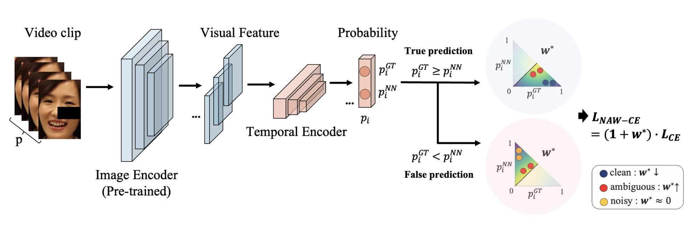

<h2 align="center">V-NAW: Video-based Noise-aware Adaptive Weighting<br>for Facial Expression Recognition</h2>
<p align="center">
  <a href="https://jungyu0413.github.io/"><strong>JunGyu Lee</strong></a>
  ·
  <a href="https://prl.kangwon.ac.kr/"><strong>Kunyoung Lee</strong></a>
  ·
  <a href="https://scholar.google.com/citations?user=UG-9gMYAAAAJ"><strong>Haesol Park</strong></a>
  ·
  <a href="https://sites.google.com/view/ijkim"><strong>Ig-Jae Kim</strong></a>
  ·
  <a href="https://vig.kist.re.kr"><strong>Gi Pyo Nam</strong></a>
  <br>
  CVPR 2025 Workshops (8th ABAW) · 🏆 5th place, Expression Recognition Track
</p>

<p align="center">
  <a href="https://jungyu0413.github.io/V-NAW/"><strong><code>Project Page</code></strong></a>
  <a href="https://openaccess.thecvf.com/content/CVPR2025W/ABAW/html/Lee_V-NAW_Video-based_Noise-aware_Adaptive_Weighting_for_Facial_Expression_Recognition_CVPRW_2025_paper.html"><strong><code>CVPRW Paper</code></strong></a>
  <a href="https://arxiv.org/abs/2503.15970"><strong><code>arXiv</code></strong></a>
  <a href="https://affective-behavior-analysis-in-the-wild.github.io/8th/"><strong><code>ABAW Challenge</code></strong></a>
  <a href="https://jungyu0413.github.io/NLA/"><strong><code>Image Model (NLA)</code></strong></a>
  <a href="#-citation"><strong><code>Citation</code></strong></a>
</p>

<div align="center">
  <br>
  <br>V-NAW: a pre-trained image encoder and a temporal encoder predict each clip, and NAW re-weights the loss by the clip's ambiguity.
</div>

<br>**Summary**: Video-based facial expression recognition on **Aff-Wild2** that carries the noise- and imbalance-aware weighting of [NLA](https://github.com/jungyu0413/NLA) to **video clips**, together with augmentations that reduce **frame-to-frame redundancy**.

<br>

## 🎬 V-NAW Framework
* **Clip-level adaptive weighting**: Frame-wise probabilities from the temporal encoder are averaged into a clip prediction, and Noise-aware Adaptive Weighting (NAW) weights the loss by how ambiguous the clip is, which also boosts minority expressions.
* **Frame skipping**: Randomly dropping frames inside a clip (for example 20–40%) stops the model from overfitting to near-identical consecutive frames.
* **In-frame random erasing**: The same 20% of pixels is masked in every frame of a clip, so the model cannot rely on one facial region.
* **Strong image prior**: A Swin Transformer image encoder is first trained with NLA on FERPlus, RAF-DB, and AffectNet, then a Transformer encoder models temporal context.
* **Vision only**: No audio or text features, yet 5th place in the EXPR track of the 8th ABAW Challenge.

<br>

## 📊 Results
Macro F1 (%) over the 8 expression classes on the official Aff-Wild2 validation set. The official challenge baseline scores 25.00.

| Aug | NAW | Neutral | Anger | Disgust | Fear | Happiness | Sadness | Surprise | Other | **Avg.** |
| :-: | :-: | :-: | :-: | :-: | :-: | :-: | :-: | :-: | :-: | :-: |
| | | 48.67 | 42.46 | 27.44 | 17.26 | 42.10 | 47.16 | 22.23 | 45.96 | 36.66 |
| ✓ | | 52.56 | 42.11 | 26.66 | 17.93 | 43.73 | 48.99 | 24.25 | 47.64 | 37.98 |
| | ✓ | 50.12 | 45.67 | 34.89 | 19.78 | 45.02 | 50.13 | 29.10 | 47.34 | 40.26 |
| ✓ | ✓ | 57.12 | 45.76 | 33.45 | 23.34 | 43.67 | 50.12 | 30.23 | 50.82 | **41.81** |

<details>
<summary><b>Cross-validation folds</b> (click to expand)</summary>

<br>F1 (%) with three additional 7:3 train/validation splits.

| Val Set | Neutral | Anger | Disgust | Fear | Happiness | Sadness | Surprise | Other | **Avg.** |
| :-- | :-: | :-: | :-: | :-: | :-: | :-: | :-: | :-: | :-: |
| Official | 57.12 | 45.76 | 33.45 | 23.34 | 43.67 | 50.12 | 30.23 | 50.82 | 41.81 |
| Fold 1 | 55.98 | 35.12 | 24.76 | 20.45 | 55.23 | 54.34 | 34.45 | 40.89 | 40.15 |
| Fold 2 | 50.34 | 41.89 | 23.45 | 22.76 | 47.12 | 52.98 | 32.78 | 42.22 | 39.19 |
| Fold 3 | 52.45 | 38.12 | 23.34 | 22.98 | 38.78 | 54.45 | 33.67 | 47.12 | 38.86 |

</details>

<br>

## 🚀 Getting Started
### Setup
**Environment**
<br>The code is written in Python 3.8 with PyTorch. Install the remaining dependencies with:
```bash
git clone https://github.com/jungyu0413/V-NAW.git
cd V-NAW
pip install torch torchvision timm numpy pandas opencv-python pillow tqdm wandb torchsampler onnxruntime
```
Training logs are sent to [Weights & Biases](https://wandb.ai). Run `wandb login` first, or set `WANDB_MODE=offline` to log locally.

**Dataset**
<br>Request [Aff-Wild2](https://ibug.doc.ic.ac.uk/resources/aff-wild2/) through the ABAW Challenge. The loader expects the cropped and aligned frames, one folder per video with frames named `00001.jpg`, `00002.jpg`, …, and the per-video EXPR annotation `.txt` files for the train and validation sets (for example, `EXPR_Recognition_Challenge/Train_Set` and `EXPR_Recognition_Challenge/Validation_Set` from the ABAW annotation release).
Set the frame root in [`data/data_loader.py` lines 543 and 547](data/data_loader.py#L543-L547).

**Pre-trained image encoder**
<br>V-NAW starts from a frame-level Swin Transformer trained with [NLA](https://github.com/jungyu0413/NLA) on FERPlus, RAF-DB, and AffectNet. Set its checkpoint path in [`src/model.py` line 103](src/model.py#L103).

### Training
Single GPU (set the GPU id in [`train_exp.py` line 3](train_exp.py#L3)):
```bash
python train_exp.py \
  --train_csv_path <ANNOTATIONS>/EXPR_Recognition_Challenge/Train_Set \
  --valid_csv_path <ANNOTATIONS>/EXPR_Recognition_Challenge/Validation_Set
```
Multiple GPUs with DistributedDataParallel, one process per GPU listed in [`DDP_train_exp.py` line 3](DDP_train_exp.py#L3):
```bash
python DDP_train_exp.py \
  --train_csv_path <ANNOTATIONS>/EXPR_Recognition_Challenge/Train_Set \
  --valid_csv_path <ANNOTATIONS>/EXPR_Recognition_Challenge/Validation_Set
```
The defaults match the paper: Swin backbone, 100-frame clips, AdamW with learning rate 1e-4, and the full objective (`--type NLA`). The model with the best validation F1 is saved under `--output_dir` (default `./weights`).

<br>

## 📖 Citation
If you find this work useful for your research, please cite our papers :)

[**`🎬 V-NAW (CVPRW'25) 🎬`**](https://github.com/jungyu0413/V-NAW) **|**
[**`😐😲 NLA (AAAI'25) 😢😠`**](https://github.com/jungyu0413/NLA)

```bibtex
@inproceedings{lee2025vnaw,
  title={V-NAW: Video-based Noise-aware Adaptive Weighting for Facial Expression Recognition},
  author={Lee, JunGyu and Lee, Kunyoung and Park, Haesol and Kim, Ig-Jae and Nam, Gi Pyo},
  booktitle={Proceedings of the IEEE/CVF Conference on Computer Vision and Pattern Recognition (CVPR) Workshops},
  month={June},
  year={2025},
  pages={5689--5696}
}
```
<details>
  <summary>More Information (Click to expand)</summary>

```bibtex
@inproceedings{lee2025navigating,
  title={Navigating Label Ambiguity for Facial Expression Recognition in the Wild},
  author={Lee, JunGyu and Choi, Yeji and Kim, Haksub and Kim, Ig-Jae and Nam, Gi Pyo},
  booktitle={Proceedings of the AAAI Conference on Artificial Intelligence},
  volume={39},
  number={4},
  pages={4517--4525},
  year={2025},
  doi={10.1609/aaai.v39i4.32476}
}
```
</details>

<br>

## 🙏 Acknowledgements
This research was supported by the KIST Institutional Program (Project No. 2E33612).
